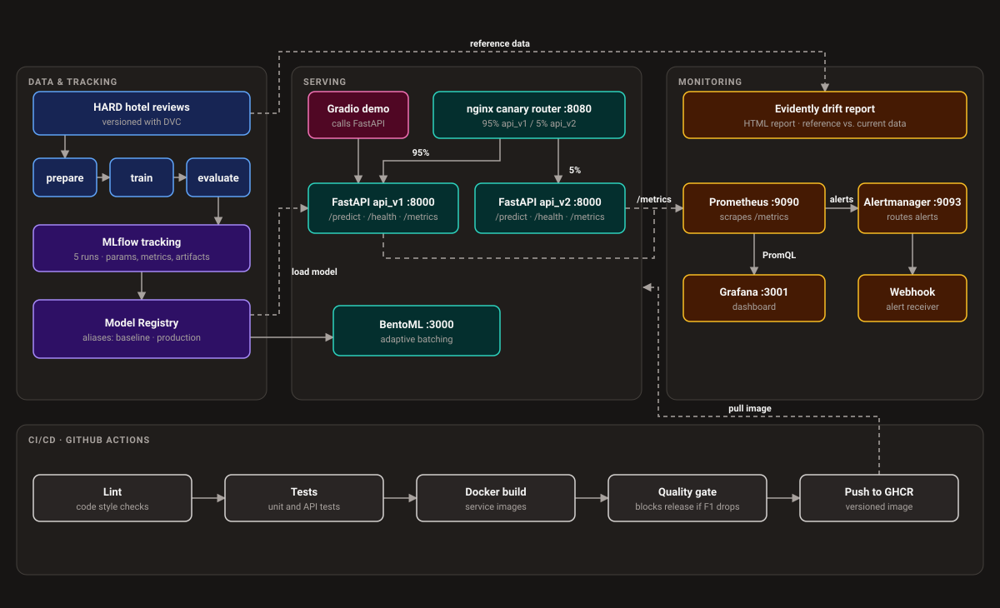

# Arabic Sentiment MLOps

[](https://github.com/Moataz-Elzuhery/Arabic-Sentiment-MlOps/actions/workflows/ci.yml)
[](https://www.python.org/downloads/)
[](https://docs.astral.sh/ruff/)
[](https://mlflow.org/)
[](https://dvc.org/)
[](https://fastapi.tiangolo.com/)
[](https://www.bentoml.com/)
[](https://prometheus.io/)
[](https://grafana.com/)
[](https://www.docker.com/)
[](https://huggingface.co/aubmindlab/bert-base-arabertv02)

**Arabic hotel-review sentiment classification (positive / negative / neutral) with an end-to-end
MLOps pipeline.** AraBERT fine-tuned on the HARD dataset (Modern Standard Arabic and dialects),
served with FastAPI and BentoML, with MLflow tracking, DVC, a CI/CD quality gate, load testing,
a canary release and drift monitoring (Prometheus, Grafana, Evidently).

The point of the project is the **system around the model**, not a record-breaking score.

## Status

| Area | What is in the repo | State |
|---|---|---|
| Model + API + Docker | Fine-tuned AraBERT, FastAPI (`/predict`, `/health`), Docker Compose | Done |
| Experiment tracking | MLflow: 5 runs, Model Registry (`baseline` / `production`) | Done |
| Data & pipeline versioning | DVC (`prepare` -> `train` -> `evaluate`) | Done (smoke-sized params) |
| CI/CD | GitHub Actions: lint, tests, Docker build, quality gate, push to GHCR | Done |
| Serving & load testing | Locust baseline, BentoML with adaptive batching | Done |
| Canary release | nginx 95/5 split, staged rollout, instant rollback | Done |
| Monitoring | PSI drift on input length and confidence, Prometheus, Grafana, alerts, Evidently report | Done |

## Architecture


```

## Results

### Data
[HARD](https://github.com/elnagara/HARD-Arabic-Dataset) (Hotel Arabic-Reviews Dataset; reviews collected
from Booking.com in June/July 2016, in Modern Standard Arabic and dialects), unbalanced version. Ratings were mapped to labels: 1-2 -> negative, 3 -> neutral, 4-5 -> positive.
After removing duplicate texts: **train 320,064 / val 40,008 / test 40,009** (stratified 80/10/10,
about 67% positive, 20% neutral, 13% negative).


### Model
`aubmindlab/bert-base-arabertv02` fine-tuned for 3-class classification (max length 128,
AdamW, 10% warmup, weight decay 0.01, seed 42, fp16 on GPU). Text is normalised before tokenising
(diacritics, tatweel, elongated letters, URLs, whitespace) in `src/preprocessing.py`; the same
function runs at training and serving time.

### Hyperparameter runs (MLflow experiment `arabic-sentiment`)
Each run trained on a random 60,000-review subset of the training set, on a Colab T4.
Model selection used **validation** F1; the test set is only reported.

| Run | LR | Batch | Epochs | Val F1 (macro) | Test F1 (macro) | Test acc. | F1 neutral | Train time |
|---|---|---|---|---|---|---|---|---|
| **run4** (selected) | 3e-5 | 16 | 2 | **0.8529** | 0.8474 | 0.8979 | 0.758 | 15 min |
| run2 | 3e-5 | 8 | 2 | 0.8513 | 0.8470 | 0.8971 | 0.757 | 21 min |
| run1 | 2e-5 | 8 | 2 | 0.8494 | 0.8468 | 0.8975 | 0.756 | 21 min |
| run5 | 3e-5 | 16 | 3 | 0.8489 | 0.8460 | 0.8960 | 0.758 | 23 min |
| run3 | 5e-5 | 8 | 3 | 0.8423 | 0.8381 | 0.8918 | 0.745 | 32 min |

Registered model `arabic-sentiment`: **v1** (alias `baseline`) and **v2** (alias `production`,
= run4). v1 and v2 use the same configuration and seed, so their test scores are identical
(F1 macro 0.8474). Per class for v1: negative 0.834, neutral 0.758, positive 0.950.

How to read this: the differences between the first four runs are small and each run used a single
seed, so I do not claim any of them is better than another. The higher learning rate (run3) was
clearly the worst. Neutral is the hardest class in every run (3-star reviews often mix praise and
criticism).

## Quickstart

Requirements: Docker and Git (Python 3.12 only for the tests). To run the API you only need the
trained model; the dataset is only needed to retrain.

## Demo

A Gradio app that talks to the running API: single review analysis with an optional star-rating check, batch analysis with CSV export, and a traffic simulator for the monitoring and canary demos.

```powershell
pip install -r requirements-demo.txt
docker compose up -d --build api
python app.py        # http://127.0.0.1:7860
```

### 1. Get the code and the model

Linux / macOS:
```bash
git clone https://github.com/Moataz-Elzuhery/Arabic-Sentiment-MlOps.git && cd Arabic-Sentiment-MlOps
mkdir -p models/v1
curl -L https://github.com/Moataz-Elzuhery/Arabic-Sentiment-MlOps/releases/download/models-v1/models-v1.tar.gz | tar -xz -C models/v1
```

Windows (PowerShell):
```powershell
git clone https://github.com/Moataz-Elzuhery/Arabic-Sentiment-MlOps.git; cd Arabic-Sentiment-MlOps
New-Item -ItemType Directory -Force models\v1 | Out-Null
curl.exe -L https://github.com/Moataz-Elzuhery/Arabic-Sentiment-MlOps/releases/download/models-v1/models-v1.tar.gz -o models-v1.tar.gz
tar -xzf models-v1.tar.gz -C models\v1
```

### 2. Run the API

```bash
cp .env.example .env              # Windows: Copy-Item .env.example .env
docker compose up -d --build api
curl -s localhost:8000/health     # {"status":"healthy"}
curl -s localhost:8000/predict -H "Content-Type: application/json" -d '{"text":"good product"}'
```
Windows: use `curl.exe` or `Invoke-RestMethod -Uri http://localhost:8000/predict -Method Post -ContentType "application/json" -Body '{"text":"good product"}'`.

### 3. Run the tests

```bash
python3 -m venv .venv && source .venv/bin/activate    # Windows: python -m venv .venv; .\.venv\Scripts\Activate.ps1
pip install -r requirements-ci.txt
pytest -q
```

### Troubleshooting
- `/health` returns 503: the model folder is missing or empty; `models/v1` must contain `model.safetensors`.
- Port 8000 is busy: set `API_PORT=8001` in `.env` and recreate the container.
- Container says "Started" but the port does not answer: `docker compose up -d --force-recreate api`.

## MLOps

### MLflow
Five runs are tracked (parameters, validation/test metrics, training time). The runs were produced
on Colab (`notebooks/train_sweep_colab.ipynb`) and the tracking database was copied back. Models are
registered with `scripts/register_model.py`:

```powershell
python -m scripts.register_model --model-dir models/v1 --alias baseline
python -m scripts.register_model --model-dir models/v2 --alias production
mlflow ui --backend-store-uri sqlite:///mlflow.db     # http://127.0.0.1:5000
```

### DVC pipeline
`dvc.yaml` defines `prepare` -> `train` -> `evaluate`; the raw dataset is tracked with
`data/raw/unbalanced-reviews.txt.dvc`. Stages are cached and re-run only when their inputs change.

```powershell
dvc repro            # whole pipeline
dvc dag              # show the graph
dvc metrics show
```

Important: the default `params.yaml` is **smoke-sized** (200 samples, 1 epoch) so `dvc repro`
finishes in minutes on a CPU. Its metrics (`metrics/eval.json`, F1 ~0.25) are therefore not the
model's quality. The registered v1/v2 models were trained on Colab with the same `src.train` code
at 60,000 samples. The full-scale parameters are noted in `params.yaml`. The dataset itself is not
stored in a DVC remote, so download `unbalanced-reviews.tsv.rar` from the `data/` folder of the HARD repository, extract it
(it is a RAR archive; use 7-Zip or WinRAR) and place the extracted file at
`data/raw/unbalanced-reviews.txt` (rename it if needed) before `dvc repro`.

### CI/CD (GitHub Actions)
On every push and pull request (`.github/workflows/ci.yml`):

1. **Lint + Tests** - `ruff` and `pytest`.
2. **Build Docker image** - builds the API image and checks that the container boots (without a
   model mounted, `/health` must answer 503).
3. **Quality gate** - `scripts/quality_gate.py` compares the candidate metrics
   (`metrics/production.json`) with the baseline (`metrics/baseline.json`) and fails if macro F1
   drops by more than 0.005, or if any class falls below an F1 of 0.70.
4. **Push image** - only on the default branch and only after the gate passes; publishes to GitHub
   Container Registry.

The gate was verified on a pull request: with F1 lowered to 0.8074 it failed, and the push job was
skipped. Note what the gate is: it checks the **metrics files committed to git**. CI has no GPU and
no model, so it does not retrain; it blocks committing results worse than the baseline.

## Serving and load testing

Method: Locust, 10 concurrent users with 0.1-0.5 s think time, 90 s per run, ramp-up discarded
(`--reset-stats`), each service run alone. Hardware: Intel Core i9-10885H (8 cores / 16 threads),
16 GB RAM, Windows, Docker Desktop (containers get 4 CPUs and about 5.8 GiB of RAM, as reported by
`docker info`). Locust and the service share the same machine, so absolute numbers are specific to
this setup and CPU-only inference.

| Service | Req/s | p50 | p95 | p99 | Failures |
|---|---|---|---|---|---|
| FastAPI (one request at a time) | 19.06 | 200 ms | 340 ms | 400 ms | 0 |
| BentoML (adaptive batching) | 21.06 | 160 ms | 290 ms | 380 ms | 0 |

Raw data and per-run summaries: `benchmarks/`.

Notes:
- Each number comes from **one run**. BentoML is lower on p50 and mean latency (~20-27%); the p99
  and requests/s differences are small and I would not call them improvements without repeats.
- With think time, requests/s is mostly determined by latency (10 users / (0.3 s + latency)), so it
  is not a capacity measurement.
- A first FastAPI run that included the ramp-up had p99 = 6,600 ms: the first requests after
  start-up are slow (likely model warm-up), which is why the table uses `--reset-stats` and why a
  warm-up before taking traffic is worth having.
- BentoML's `max_latency_ms` must be larger than the model's latency under load. With 50 ms, about
  half of the requests were rejected with HTTP 503 in my tests; the default here is 2000 ms.

```powershell
docker compose --profile bento up -d --build bento     # BentoML on :3000, POST /predict {"texts": ["..."]}
```

## Canary release

`docker compose --profile canary up -d --build` starts two copies of the API (`api_v1` stable,
`api_v2` candidate) behind an nginx router on port 8080. Each request is assigned independently, so
shares are statistical. A check with 400 requests at `CANARY_PCT=5` gave 95.8% v1 / 4.2% v2.

```powershell
python -m scripts.canary_check --url http://localhost:8080 --n 400 --expected 5
```

Rollout stages (5% -> 25% -> 50% -> 100%), promotion criteria and the measured per-version latency
are in [`docs/canary_rollout.md`](docs/canary_rollout.md). Rollback is instant: set
`CANARY_ENABLED=0` and recreate the router (nginx rejects a 0% split, hence the separate switch).

Here v1 and v2 are the same model configuration, so the canary demonstrates the **routing and
rollout mechanics**; model quality is controlled separately by the quality gate. Because both versions run the same
weights, any latency difference between them in the rollout log is noise (small samples at low
shares, one run per stage), not a model effect.

## Monitoring and drift detection

The FastAPI service exports Prometheus metrics at `/metrics`: request rate and latency, prediction
labels, the distribution of model **confidence** and of **input text length**, and two drift gauges.
Drift is the **Population Stability Index (PSI)** of text length and confidence over the last 300
requests against a reference sample of 2,000 validation reviews scored by the production model
(`monitoring/reference.csv`). Rule of thumb: PSI below 0.1 is stable, 0.1-0.25 a moderate shift and
above 0.25 a significant shift. Only lengths, confidences and labels are recorded, never review text.

When PSI stays above **0.25** for a minute, Prometheus fires `DataDriftHigh`; Alertmanager forwards it
to a webhook receiver, and the alert resolves when traffic returns to normal. There are also alerts
for API down, 5xx rate and p95 latency. A Grafana dashboard shows the live signals, and
`scripts/drift_report.py` builds an Evidently HTML report on the most recent requests.

```powershell
python -m scripts.build_reference --model-dir models/v1 --val-path data/processed/val.csv --n 2000 --output monitoring/reference.csv
docker compose --profile monitoring up -d --build        # Grafana :3001, Prometheus :9090, Alertmanager :9093
python -m scripts.simulate_traffic --url http://localhost:8000 --mode normal --n 300 --rate 5
python -m scripts.simulate_traffic --url http://localhost:8000 --mode short  --n 500 --rate 5
```

The "short" mode sends only the first 1-3 words of each review, so the drift is **synthetic**: it
demonstrates detection and alerting, not a real change in users. Full description, thresholds, alert
table and limitations: [`docs/monitoring.md`](docs/monitoring.md).

## Configuration

Docker Compose reads `.env` (copy it from `.env.example`; `.env` is git-ignored).

| Variable | Default | Used by |
|---|---|---|
| `API_MODEL_DIR` | `/app/models/v1` | `api`, `bento` |
| `STABLE_MODEL_DIR` / `CANARY_MODEL_DIR` | `/app/models/v1` / `/app/models/v2` | canary services |
| `MAX_BATCH_SIZE` / `MAX_LATENCY_MS` | `32` / `2000` | BentoML batching |
| `CANARY_PCT` | `5` | share of traffic to the canary (1-100) |
| `CANARY_ENABLED` | `1` | `0` = rollback to the stable model |
| `DRIFT_WINDOW` / `DRIFT_MIN_SAMPLES` | `300` / `100` | drift window size / minimum requests before PSI is computed |
| `GRAFANA_ADMIN_PASSWORD` | `admin` | Grafana login for the local demo stack (change if exposed) |

A variable set in the shell (`$env:CANARY_PCT=25`) overrides `.env`.

## Project structure

```
src/                  preprocessing, model, training, evaluation, inference, FastAPI app, monitoring, MLflow helper
scripts/              prepare_data, register_model, export_metrics, quality_gate, locust_summary,
                      canary_check, build_reference, simulate_traffic, drift_report
configs/train.yaml    default training configuration
params.yaml           DVC parameters (smoke-sized by default)
dvc.yaml / dvc.lock   pipeline definition and lock file
service.py            BentoML service (adaptive batching)
canary/               nginx config template for the traffic split
monitoring/           Prometheus, alert rules, Alertmanager, webhook receiver, Grafana provisioning,
                      drift reference sample (reference.csv)
loadtest/             Locust file
benchmarks/           load-test summaries and raw Locust CSVs
metrics/              eval.json (DVC), production.json and baseline.json (CI gate)
notebooks/            Colab notebooks used for GPU training
docs/                 canary rollout plan and log, monitoring guide
tests/                pytest suite
.github/workflows/    CI
Dockerfile, Dockerfile.bento, docker-compose.yml, requirements*.txt, .env.example
```

## Reproducing the training

Fine-tuning needs a GPU. On a Colab T4, `notebooks/train_sweep_colab.ipynb` runs the five
configurations (about 15-32 minutes each at 60,000 samples) and logs them to MLflow;
`notebooks/train_colab.ipynb` runs a single configuration. Both copy the project from Google Drive
(see the notebook header for the expected folder layout). Training locally on a CPU measured about
2 samples per second, which is not practical for this dataset.

## Limitations

- The model was trained on **hotel** reviews. It has not been evaluated on product reviews, so
  accuracy on e-commerce text is unknown and likely lower (domain shift, dialect).
- Neutral is the weakest class (F1 about 0.76). Class weights or more data for that class were not tried.
- Single seed per configuration; no confidence intervals.
- Trained on a 60,000-review subset of the 320,064 training reviews.
- Load-test numbers are from one machine, one run each, CPU-only.
- v1 and v2 are the same configuration, so the canary does not compare two different models.
- The DVC pipeline's default parameters are a smoke test, and the dataset is not in a DVC remote.
- Monitoring watches two features (input length, confidence) with PSI. There are no ground-truth
  labels in production, so accuracy itself is not monitored, and the demonstrated drift is synthetic.
  Only the FastAPI service is instrumented.

## Next steps (not implemented)

- Collect delayed ground-truth labels to monitor accuracy, not only input drift.
- Add embedding-based drift and per-class output drift.
- Replace the demo webhook receiver with a real notification channel (Slack or e-mail).

## Dataset citation

Elnagar A., Khalifa Y.S., Einea A. (2018). *Hotel Arabic-Reviews Dataset Construction for Sentiment
Analysis Applications.* In: Shaalan K., Hassanien A., Tolba F. (eds) Intelligent Natural Language
Processing: Trends and Applications. Studies in Computational Intelligence, vol 740, pp. 35-52.
Springer International Publishing.
https://doi.org/10.1007/978-3-319-67056-0_3
